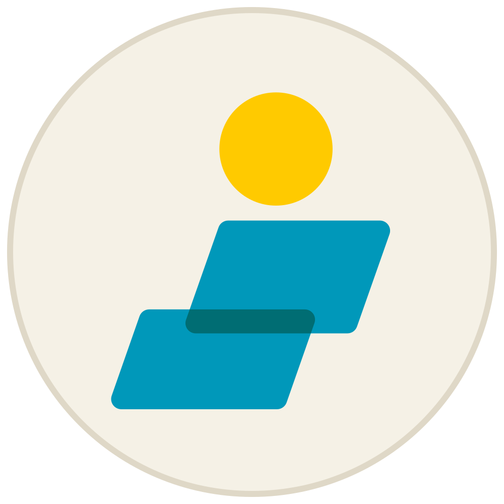
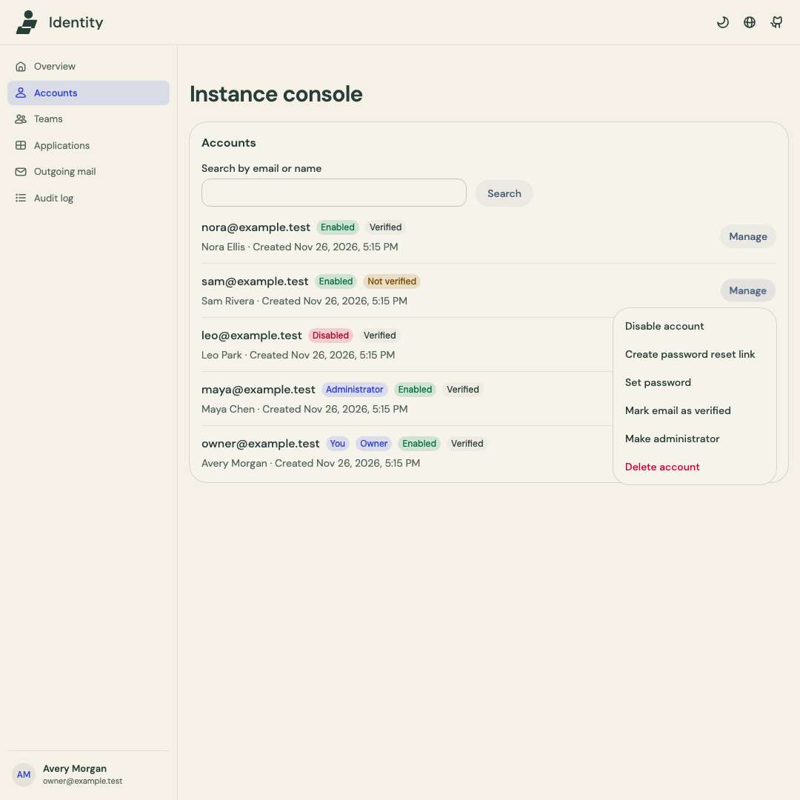
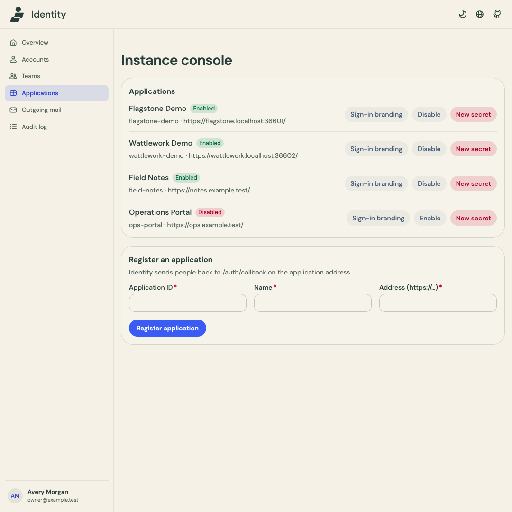
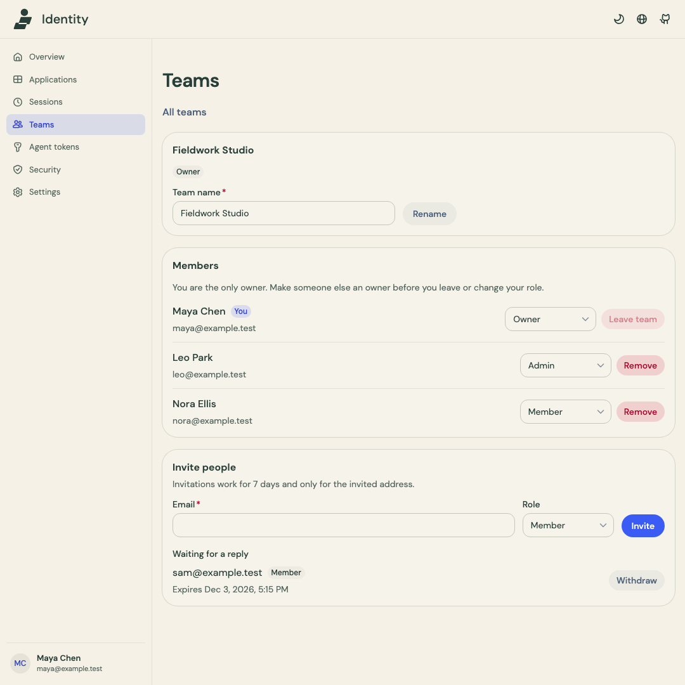

# Niltavi Identity

*User authentication infrastructure for the AI era. Run it as your authentication server, add it as a sign-in option, or deploy it locally.*

[Website](https://identity.niltavi.com/) · [Integration guide](docs/en/integration.md) · [简体中文](docs/zh-CN/README.md)

---

Identity is an OpenID Connect provider for your applications. Use it for primary sign-in or offer it alongside an existing login. Once users sign in, they can open other connected apps and manage their sessions from one account center.

Users can sign in with a password or, when outgoing mail is configured, an email code. They can also issue revocable access tokens for an MCP client or command-line tool, scoped to one application and one team.

Run Identity on your own machine with Docker Compose. The admin console lets you manage accounts, register applications, and set the registration policy for your instance.

 

 

<a href="docs/en/for-agents.md">For agents</a>
<a href="https://niltavi.com/">
<picture>
  <source media="(prefers-color-scheme: dark)" srcset="web/src/brand/niltavi-logo-dark.svg" />
  
</picture>
</a>

