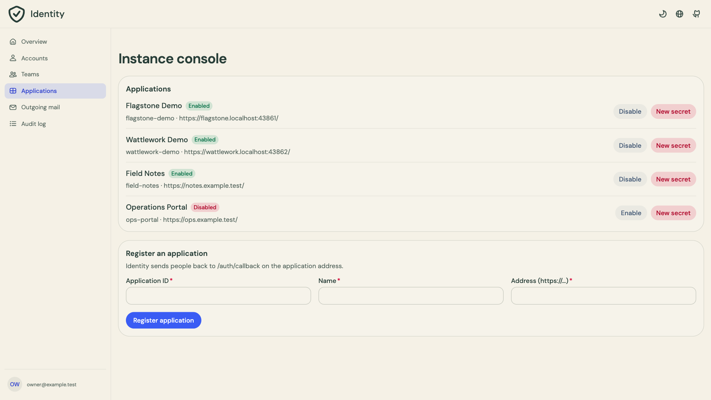
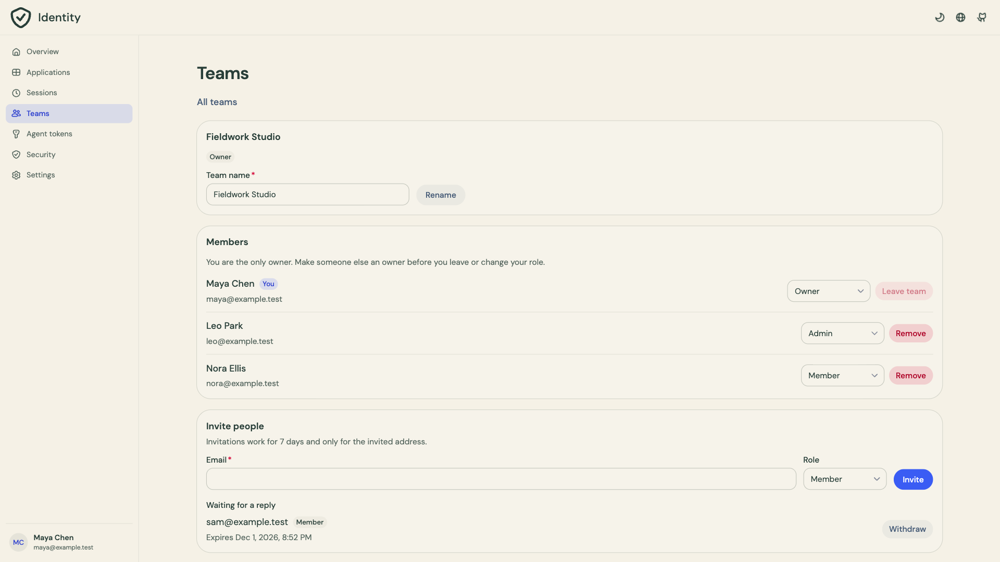

# Niltavi Identity

Self-hosted accounts and OpenID Connect single sign-on for your applications. Users can sign in across connected apps and manage their sessions in one place.

[Try the test deployment](https://identity.testenv.niltavi.com/)

## Screenshots

English screenshots from a running Identity instance with demo data.

### Accounts

### Applications

### Teams

 

<a href="docs/en/for-agents.md">For Agents</a>
<a href="https://niltavi.com/">
<picture>
  <source media="(prefers-color-scheme: dark)" srcset="web/src/brand/niltavi-logo-dark.svg" />
  
</picture>
</a>

