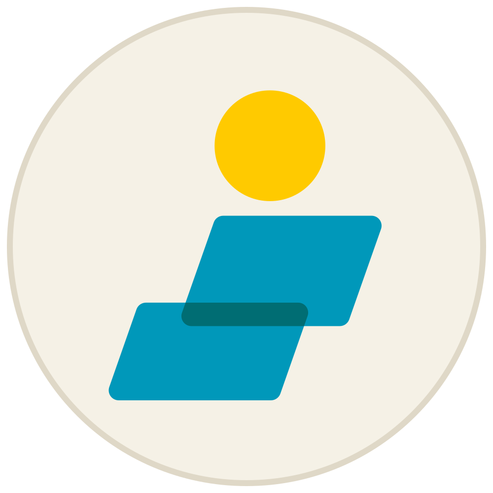
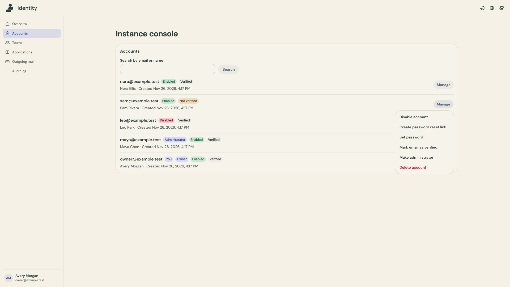
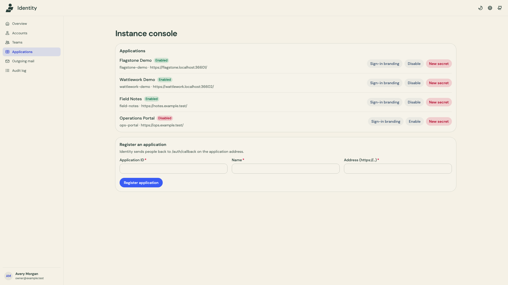
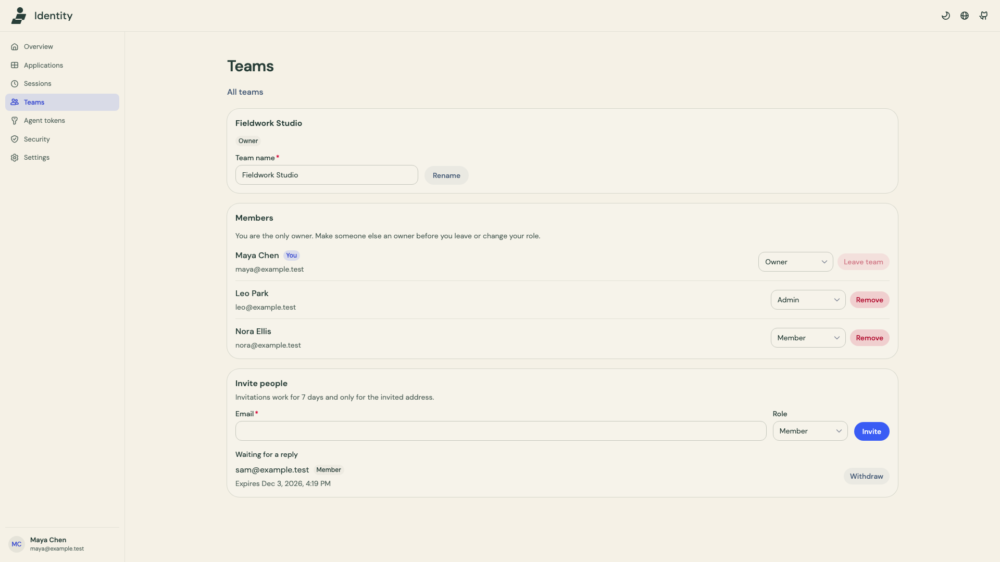

# Niltavi Identity

*AI 时代的用户身份认证基础设施。服务端、登录方式、本地部署，一站式支持*

[试用测试环境](https://identity.testenv.niltavi.com/zh/) · [接入指南（英文）](../en/integration.md) · [English](../../README.md)

---

Identity 通过 OpenID Connect 为应用提供登录服务。你可以把它用作主要登录方式，也可以和现有方式一起提供给用户。用户登录一次就能打开其他已接入的应用，在同一个账号中心管理登录会话。

用户可以用密码登录，配置邮件发送后也可以用邮箱验证码登录。用户还可以为 MCP 客户端或命令行工具创建可撤销的访问令牌，每个令牌只对应一个应用和一个团队。

用 Docker Compose 就能在自己的机器上运行 Identity。管理员可以在控制台管理账号、登记应用，并为当前实例设置注册策略。

 

 

<a href="../en/for-agents.md">For agents</a>
<a href="https://niltavi.com/">
<picture>
  <source media="(prefers-color-scheme: dark)" srcset="../../web/src/brand/niltavi-logo-dark.svg" />
  
</picture>
</a>

